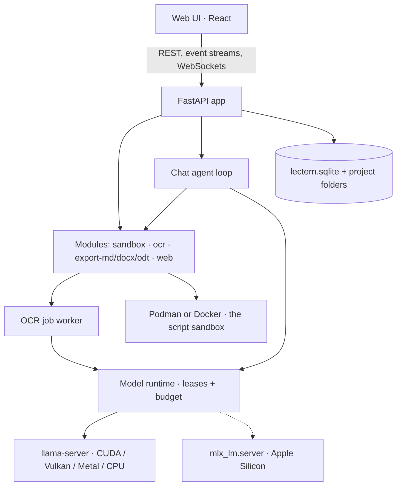

# Architecture

One Python process serves the API and the built UI. It starts each model in a runner process
of its own and talks to it over HTTP on `127.0.0.1`.



## Code map

| Path | What's there |
|---|---|
| `src/lectern/app.py`, `cli.py`, `config.py` | the app, the `lectern` command, paths and settings |
| `core/` | security middleware, accounts and passwords, the app database and settings |
| `api/` | the HTTP and WebSocket routes |
| `projects/` | project folders, files, the project database, text extraction, search |
| `agent/` | the chat: loop, tools, context, compaction, pins, follow-ups ([The chat](agent.md)) |
| `modules/` | the built-in modules (below) |
| `documents/` | the Document format and the export framework ([OCR](ocr.md)) |
| `hardware/`, `catalog/`, `runtime/`, `runners/`, `downloads/` | [Models and memory](models.md) |
| `dev/` | `lectern dev` checks and their prompt sets |
| `web/` | the React UI, built into `src/lectern/web_dist/` and shipped in the wheel |
| `packaging/` | the installers for Linux, macOS and Windows, and the Docker image |

## Stack

- **Backend:** Python 3.12, FastAPI on Uvicorn, Typer for the CLI, SQLAlchemy 2 and Alembic
  on SQLite (WAL), httpx2 for outgoing HTTP. PDFs through pypdfium2, images through Pillow,
  DOCX through python-docx, ODT through odfdo, passwords through argon2-cffi, web search
  through ddgs.
- **Frontend:** TypeScript, React, Vite, TanStack Router and Query, Tailwind, react-markdown
  with remark-gfm (no raw HTML). Every string goes through i18next; English is the one
  language so far.
- **Tooling:** uv, ruff and pytest; npm, ESLint and Vitest. CI runs the lints, the web build
  and both test suites on Linux (`.github/workflows/ci.yml`).
- **Licence:** Apache-2.0.

## Databases

Two kinds, each migrated in-process on start by its own Alembic tree:

- **The app database**, `<data>/lectern.sqlite` (`core/tables.py`,
  `src/lectern/migrations/`): users and logins, settings, projects, downloads.
- **Each project's database**, `<project>/.lectern/project.sqlite` (`projects/tables.py`,
  `src/lectern/project_migrations/`): sessions and their messages, confirmations, files and
  where they came from, script runs, chat state (pins, summary, follow-ups), open tabs, OCR
  sessions, pages and decisions, and the FTS5 search index.

A schema change is a new version in the tree that owns the table. The model catalog isn't in
a database: it's `catalog/models.yaml`, shipped with the code.

## Modules

A module is a Python package registered under the `lectern.modules` entry point
(`pyproject.toml`); one that fails to load is logged and skipped. The built-in ones are
`sandbox`, `ocr`, `export-md`, `export-docx`, `export-odt` and `web`. The contract
(`modules/__init__.py`):

```python
class Module(Protocol):
    id: str
    def tools(self, env: ToolEnv) -> list[AgentTool]: ...
    # optional: router (an APIRouter, mounted under /api behind current_user)
    # optional: exporters() -> list[Exporter]
```

`tools()` is called for every chat turn with what the install has (`ToolEnv`: whether a
sandbox engine answers, whether web search is on and its key), so a module offers only the
tools that can work. An `AgentTool` has a name, a description, a pydantic model for its
arguments, whether it asks first, the text of its card, and its result's token limit
(`agent/tools.py`).

An export module returns exporters (`documents/export.py`):

```python
class Exporter(Protocol):
    format: str                    # "odt"
    title: str                     # "Export · ODT": the From of the files it writes
    extension: str                 # ".odt"
    mime: str
    capabilities: frozenset[str]   # of "tables", "comments", "figures"
    def export(self, doc: Document, opts: ExportOptions) -> bytes: ...
```

Modules don't import each other; they share project files and the core's services. The
session kinds (chat, OCR) and their screens are part of the core and the UI, not added by
modules, and the modules are built into the app.

## The `lectern` command

| Command | What it does |
|---|---|
| `lectern serve` | Start the server (`--port`, default 8765; `--host`; `--public-url`; `--no-browser`) and print the access link |
| `lectern url` | Print the access link with its token |
| `lectern user init <name>` | Turn accounts on; the local user becomes this admin |
| `lectern user add <name> [--admin]` | Add a person |
| `lectern user password <name>` | Set a new password and sign them out everywhere |
| `lectern user list`, `disable`, `enable` | List people; stop or allow someone signing in |
| `lectern doctor [--runners]` | Print what Lectern knows about the machine as JSON; `--runners` adds the llama.cpp build |
| `lectern chat "<prompt>"` | Send one message to a running server's chat model |
| `lectern bench` | Measure chat speed and the first token after a load against the tier's targets |
| `lectern dev agent-check`, `swap-test`, `ocr-check` | The development checks ([The chat](agent.md#checking-the-chat), [Models](models.md#checking-a-machine)) |

## Settings

From the environment, or `~/.lectern/lectern.env` when installed:

| Variable | What it does |
|---|---|
| `LECTERN_HOME` | Where the data lives (default: the OS's app-data folder; `~/.lectern/data` when installed) |
| `LECTERN_HOST` | `127.0.0.1` (default) or `0.0.0.0`, which needs `LECTERN_PUBLIC_URL` |
| `LECTERN_PUBLIC_URL` | The addresses people reach Lectern at, comma-separated |
| `LECTERN_TIER` | Use this hardware tier instead of the detected one |
| `LECTERN_BUDGET_MB` | Use this memory budget for models, in MiB |
| `LECTERN_DEV=1` | Mount the admin-only `/api/dev` routes the dev checks use |

Everything else is set in the app (Models & memory, Users, web search) and stored in the app
database.

## Installing

Each OS has an install script that builds the UI and the wheel from a copy of the repository
(or takes a wheel), installs a pinned uv and Python 3.12 into `~/.lectern`, and keeps each
version in a folder of its own so a failed install leaves the running one alone:

- **Linux:** a `systemctl --user` service (`packaging/linux/`); or the Docker image
  (`packaging/docker/`).
- **macOS:** Lectern.app in `~/Applications`, a menu-bar app built with `swiftc`, with the
  MLX extra (`packaging/macos/`).
- **Windows:** a tray app built with the `csc.exe` that ships with Windows
  (`packaging/windows/`). It stops Lectern by setting a named event (`serve --stop-event`,
  `core/winevent.py`): Windows has no Ctrl+C for a process with no console, and Lectern's
  standard input is left alone, since a thread waiting to read it made a DLL loading later
  wait with it. `serve` runs on an event loop of its own there (`core/winloop.py`): asyncio's
  stops accepting for good after one client is gone before its accept
  ([python/cpython#93821](https://github.com/python/cpython/issues/93821)). While Lectern
  runs, the tray app asks `/health` every 30 s and says in its menu when it stops answering.

The llama.cpp build for the machine is downloaded at first run. How to install and update:
the [README](../README.md).
